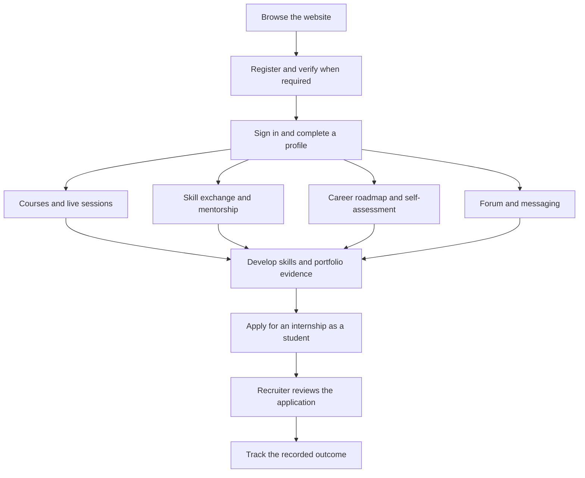
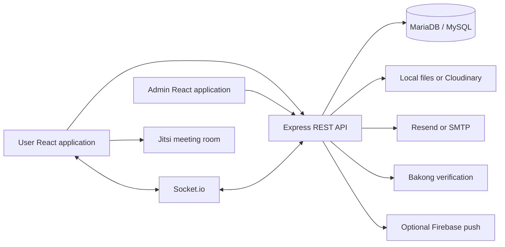

# Smart Community Skill & Career Development Platform

Full website description and functional reference. Reviewed against the local source on **October 19, 2026**.

This document explains the website for project reports, presentations, users, and developers. It describes the implementation in this repository, including incomplete features. It does not certify that a deployed website or an external integration has been tested.

## Contents

1. [Website purpose and objectives](#1-website-purpose-and-objectives)
2. [Users and permissions](#2-users-and-permissions)
3. [Website pages](#3-website-pages)
4. [Detailed functions](#4-detailed-functions)
5. [Complete user journeys](#5-complete-user-journeys)
6. [Architecture and technologies](#6-architecture-and-technologies)
7. [Database and stored information](#7-database-and-stored-information)
8. [API reference](#8-api-reference)
9. [Configuration and local setup](#9-configuration-and-local-setup)
10. [Validation and demonstration](#10-validation-and-demonstration)
11. [Current limitations and possible improvements](#11-current-limitations-and-possible-improvements)
12. [Ready-to-use project description](#12-ready-to-use-project-description)

For additional step-by-step journeys, see [Website flows](WEBSITE_FLOWS.md). The [main README](README.md) contains the shorter project introduction.

## 1. Website purpose and objectives

Smart Community Skill & Career Development Platform connects learning, peer collaboration, professional guidance, and internship opportunities in one website. Students can develop skills through courses, skill exchanges, mentorship, and live sessions, then present their experience through a profile and portfolio and apply for internships.

The project addresses a practical problem: learning resources, people who can help, professional profiles, and recruitment opportunities are often spread across separate systems. This platform gives members a shared place to find those resources and record their participation.

Its objectives are to:

- Help members find useful courses and learning resources.
- Connect people who can teach a skill with people who want to learn it.
- Make verified mentors available for guidance and appointments.
- Support live learning, discussion, and direct communication.
- Help learners organize career goals, milestones, and portfolio evidence.
- Connect students with recruiters and track internship applications.
- Give administrators tools to review accounts, moderate opportunities, and inspect platform activity.

The platform supports learning and recruitment processes; completing a course or assessment does not guarantee employment or a professional qualification.

## 2. Users and permissions

| User type | Main capabilities | Important rule |
| --- | --- | --- |
| Visitor | Browse courses and previews, mentors, sessions, internships, career resources, forum posts, and public community activity. | Participation and personal records generally require sign-in. |
| Student | Manage a profile; access enrolled courses; exchange skills; request mentorship; join sessions; use career tools, forum, messages, and notifications; apply for internships. | Internship submission specifically requires the `student` role. |
| Mentor applicant | Submit expertise and professional information for review. | Choosing Mentor during registration initially creates a student account with a pending application. |
| Approved mentor | Receive and manage mentorship bookings; host learning sessions; participate in shared member features. | Administrator approval grants mentor access. Public mentor listings also apply verification and active-account checks. |
| Recruiter | Maintain a company profile, publish internships, inspect applicants, record candidate notes, and update outcomes. | Recruitment actions apply role and ownership checks. |
| Administrator | Manage accounts, review mentors and companies, moderate internships, inspect analytics, and export reports. | Administrative API routes require the `admin` role. Public registration cannot create an administrator. |

Some older records use `user`. This legacy value should not be assumed to have every permission of `student`. Roles are not a hierarchy: an administrator or mentor does not automatically satisfy a route restricted specifically to students.

## 3. Website pages

These paths belong to `frontend_user`. Public pages can contain individual actions that require authentication.

| Page | Route | Access and purpose |
| --- | --- | --- |
| Home | `/` | Public introduction, feature navigation, team information, and FAQ. |
| Dashboard | `/dashboard` | Signed-in starting page and activity shortcuts; some content is predefined. |
| Course catalog | `/courses` | Public search, category filtering, prices, and enrollment indicators. |
| Course classroom | `/courses/:courseId` | Public outline and previews; enrollment controls locked resources. This route value is passed to the API as a course slug. |
| Live session directory | `/sessions` | Public discovery with authenticated registration and host actions. |
| Session details | `/sessions/:sessionId` | Selected session within the session directory interface. |
| Meeting room | `/sessions/:sessionId/room` | Authenticated host or eligible participant within the allowed join window. |
| Discover members | `/discover` | Signed-in member search and browsing. |
| Member details | `/discover/:memberId` | Signed-in profile viewing and collaboration entry points. |
| Community | `/community` | Public community activity and personalized skill matches when signed in. |
| Skill requests | `/skill-requests` | Signed-in incoming requests, outgoing requests, and learning history. |
| Exchange details | `/community/skill-exchange/:exchangeId` | Participant meeting information, progress, and completion controls. |
| Mentor directory | `/mentorship` | Public mentor browsing; signed-in applications and booking management. |
| Mentor profile | `/mentorship/:mentorId` | Expertise and reviews; sign-in required to book. |
| Internships | `/jobs` | Public opportunity search and student application flow. |
| Application workspace | `/applications` | Student application tracking or recruiter company, listing, and candidate tools. |
| Recruiter posts | `/my-posts` | Alternative route to the application workspace. |
| Publish internship | `/post-job` | Signed-in form; submission requires recruiter or administrator permission. |
| Career development | `/career` | Public resources; authentication required to save a roadmap or assessment. |
| Forum | `/forum` | Public questions and discussions. |
| Forum post | `/forum/:postId` | Public discussion detail; participation requires sign-in. |
| Register | `/register` | Create an account. |
| Login | `/login` | Password login or configured Google sign-in. |
| Verify email | `/verify-email` | Consume a verification token or request another link. |
| Forgot password | `/forgot-password` | Request a recovery email. |
| Reset password | `/reset-password` | Choose a new password using a valid token. |
| Profile | `/profile` | Signed-in professional profile and portfolio management. |
| Settings | `/settings` | Signed-in account form; several controls are incomplete. |
| Messages | `/messages`, `/messages/:conversationId` | Signed-in private and group conversations. |
| Notifications | `/notifications` | Signed-in activity center and delivery preferences. |
| Analytics | `/analytics` | Administrator platform reporting. |
| Administration | `/admin` | Administrator management tools inside the user application. |
| Not found | Unmatched paths | Error page with navigation back into the website. |

The separate `frontend_admin` application has its own routes: `/` for overview, `/users` for accounts, `/reviews` for mentor/company review, `/internships` for moderation, `/analytics` for reports, and `/audit` for audit history and CSV exports. Its login screen appears before these pages when no valid administrator session exists.

An About component exists in the user source, but `/about` is not registered as a page.

## 4. Detailed functions

### 4.1 Home, navigation, and language

The home page introduces the learning-to-career journey and directs visitors to the main areas. Navigation adapts to the signed-in state and provides profile, messages, notifications, and account destinations. Protected pages offer authentication and preserve a return destination for the login flow.

English and Khmer interface translations are available through the language selector. The selected language is remembered in browser storage. Translation coverage varies: some components still contain fixed English text.

Routes load their page components on demand and show loading states while preparing content. Error and not-found pages provide a recovery path when navigation fails.

### 4.2 Registration, verification, and login

**Purpose:** identify each member and connect their activity to an account.

Registration collects name, email, password, confirmation, role selection, and relevant profile details. The backend validates the request and checks for an existing account. Student, mentor-applicant, and recruiter registration support different participation goals.

With email verification enabled, the user follows a verification link before ordinary password login. Users can request a replacement verification link. The `REQUIRE_EMAIL_VERIFICATION` setting controls this requirement and defaults to enabled. Disabling it changes the registration/login verification behavior; it does not remove the feature from the source.

Password login checks credentials and account availability, then returns an access token. Remember me selects the configured longer token duration. Google sign-in is an alternative when matching Google client IDs are configured in the frontend and backend; the backend validates the Google identity token.

Forgot password creates a recovery link. A valid, unexpired reset token allows a new password to be saved. Email delivery uses the configured Resend or SMTP adapter. Development responses can expose one-time links when no provider is configured.

Signing out clears browser authentication and disconnects real-time communication. The context helper named `deleteAccount` performs this same local cleanup; it does not delete a database account.

### 4.3 Profile and portfolio

**Purpose:** give a member a professional identity and information for collaboration and career recommendations.

| Information | Available action and use |
| --- | --- |
| Personal and professional details | Edit name, biography, profession, location, career goal, and other supported profile fields. |
| Teaching and learning skills | Describe skills offered and skills wanted; these inform skill matching. |
| Social links | Provide supported professional and code-profile links. |
| Avatar | Upload a JPG, PNG, or WebP profile image. |
| Education | Add, update, or delete education entries. |
| Experience | Add, update, or delete work and practical experience entries. |
| Certificates | Record externally earned certificates and their details. |
| Portfolio | Add, update, or delete projects with descriptions, links, and optional images. |

Profile images, project images, and company logos use the image uploader, limited to one supported image up to 5 MB per request. Files use Cloudinary when configured or local upload storage otherwise. A certificate profile entry is a user-maintained record, not an automatically issued platform certificate.

### 4.4 Personal dashboard

The dashboard introduces the member's next activities: complete a profile, learn practical skills, meet peers or mentors, and explore opportunities. It links into the functional feature pages.

Some event, job-match, and course cards are predefined presentation content. A separate backend dashboard endpoint exists, but that alone does not establish that every visible dashboard card is connected to current account data. Use the dedicated course, booking, and application pages for actual records.

### 4.5 Courses and learning resources

The catalog loads published courses from the backend. Users can search course titles and descriptions and filter by category. Cards show information such as title, level, instructor, price, duration, lesson count, and enrollment status.

A course classroom shows its description, highlights, lesson outline, and available resources. Preview lessons can be opened without enrollment. Locked lesson resources are returned only when the access check succeeds. Lessons can include video and PDF links.

An authenticated user can enroll in a free course through the enrollment/payment action. A paid course uses the Bakong flow below. Existing enrollment permits continued access without another purchase.

The database contains an enrollment progress percentage and the catalog can display it. There is no current course API action for marking lessons completed, and no implemented automatic course-certificate issuance flow. The administrative routes also do not provide a complete course-authoring interface; current content is managed through the supplied database/migration content and development work.

### 4.6 Bakong KHQR course payments

**Purpose:** unlock paid course access after backend payment verification.

1. The signed-in learner chooses to purchase a course.
2. The backend reads the course price and currency from the database.
3. It returns an existing valid pending payment or generates a KHQR code with a five-minute expiry.
4. The classroom displays the code and expiry countdown.
5. The learner pays using a compatible payment application.
6. The frontend requests payment verification; the backend queries Bakong using the QR MD5 value.
7. If no successful transaction is available, the payment remains pending.
8. The backend compares the returned amount and currency. It also checks the recipient when Bakong supplies a recipient account ID.
9. A matching transaction updates the payment and creates the enrollment within a database transaction.
10. A newly confirmed purchase generates a course-unlocked notification.

Payment states include `pending`, `paid`, and `expired`. Expired codes require a new payment request. Mismatched transaction details produce an error rather than course access. The payment record stores transaction identifiers, and the schema has a unique transaction-ID constraint.

The active Smart Community integration is in `backend/src/controllers/courseController.js` and `backend/src/services/bakongPaymentService.js`. The nested `bakong-main/bakong-main` project is a separate payment example with its own README and application structure. The main service can read its backend environment file as a fallback, but the main website's course endpoints belong to the top-level backend.

The separate `telegram_bot` service accepts payment-success alert requests. The reviewed course-payment controller does not call it, so Telegram payment alerts are not an automatic part of the website purchase flow.

### 4.7 Member discovery

Signed-in members browse and search people at Discover, view a selected member's profile, and use that profile to start a conversation or request a skill exchange. Profile details help users decide whether another member's skills and goals fit their needs.

The user frontend protects Discover routes. The underlying member-list API is public, which is a distinct access boundary from the page route.

### 4.8 Skill matching and exchange

**Purpose:** let members learn from one another through an agreed exchange.

Matching compares teaching skills, learning skills, and shared interests and calculates a compatibility score. These are programmed scoring rules; the reviewed implementation does not call an external AI model for matching.

A request identifies another member, the requested skill, the offered skill, and an introductory message. The recipient can accept it with a meeting date or decline it with a reason. The sender can cancel a pending request.

Accepted exchanges provide a direct conversation and a Jitsi meeting link. Participants can record learning notes and a shared progress percentage from 0 to 100. Each participant confirms completion separately. Once both confirmations exist, the exchange becomes completed and appears in learning history.

| State | Meaning |
| --- | --- |
| `pending` | The recipient has not accepted or declined. |
| `accepted` | Participants can meet and record progress. |
| `rejected` | The recipient declined the request. |
| `cancelled` | The pending request was cancelled. |
| `completed` | Both participants confirmed completion. |

Users cannot request themselves. Duplicate active requests are checked. Progress updates require an accepted exchange. A 100% progress entry alone does not replace both completion confirmations.

### 4.9 Mentor applications and appointments

The public directory allows users to search verified mentors and review professional details, expertise, ratings, and reviews.

To become a mentor, a member submits professional background, expertise, and availability. An administrator reviews the application and approves it or rejects it with a reason. A member who selected Mentor during registration already has a pending application to track.

A learner requests a mentor appointment by supplying a topic, future date/time, duration, and meeting frequency. The mentor approves or rejects the request. Approval changes the engagement to `active` and creates a scheduled session with a Jitsi link. Pending or active engagements can be cancelled; an active engagement can be completed through its management flow.

After completion, the learner who booked the engagement can submit a rating and written review. The backend checks the booking relationship and completed state before accepting a review. Self-booking and duplicate pending/active engagements with the same mentor are blocked.

Typical state changes are `pending -> active -> completed`, with `rejected` and `cancelled` alternatives. The frequency field records the requested cadence; it does not establish automatic recurring-calendar scheduling.

### 4.10 Live learning sessions

**Host functions:** mentors and administrators can create sessions with title, description, category, level, future date/time, duration, capacity, registration deadline, and optional material links. Hosts manage session status and inspect participant attendance.

**Participant functions:** signed-in members browse sessions, register while places remain and registration is open, cancel a registration, enter an eligible meeting, and submit feedback after attendance is recorded.

The session room embeds Jitsi for audio, video, meeting chat, and screen sharing where the provider and browser permit them. Attendance records include status, join/leave information, and elapsed minutes.

Current backend rules include:

- Session duration must be 15 to 480 minutes, and capacity must be 2 to 500.
- Registration closes before the session starts and requires a session open for registration.
- The room opens 30 minutes before its scheduled time and closes to new joins two hours after its scheduled duration.
- Completed and cancelled sessions cannot be joined.
- Non-host participants need an eligible registration.
- Feedback requires recorded attendance and a rating from 1 to 5. It does not additionally require the session status to be completed.

Session states are `scheduled`, `ongoing`, `completed`, and `cancelled`. Platform route checks control access through the application; generated meeting links do not by themselves establish provider-level meeting privacy or recording guarantees.

### 4.11 Company profiles, internships, and applications

Recruiters manage their company profile with name, description, contact details, website, and an optional logo. A company profile is required before creating an internship. Administrators can review companies, but the current publishing controller does not require company approval first.

An internship includes a title, description, requirements, responsibilities, type, location or remote information, openings, relevant dates, and stipend details as applicable. Recruiters publish and manage their opportunities; listing states include `open`, `closed`, and `filled`.

Students search and filter internships, review the requirements, and submit a PDF CV with an optional portfolio URL and cover letter. CV uploads are limited to 10 MB. Applications require a student account, an eligible open listing, and a valid deadline. Duplicate applications are checked.

Recruiters inspect applications for their listings, view CV links, save private candidate notes, and update candidate status. Students use their application workspace to follow the result.

| Application status | Meaning |
| --- | --- |
| `pending` | Application received. |
| `reviewed` | Recruiter has reviewed the application. |
| `shortlisted` | Candidate selected for further consideration. |
| `approved` | Positive application outcome recorded. |
| `rejected` | Negative application outcome recorded. |

These are supported statuses, not a promise that the system requires every intermediate step. Application approval does not automatically create an employment contract or an interview calendar entry.

### 4.12 Career roadmaps, articles, and assessment

Public career resources include paths, their milestones and resources, advice articles, and available assessment questions. Authenticated members receive recommendations based on profile skills and career goals.

A member selects a roadmap as the current plan, completes milestones, and can reopen them later. Completion percentage reflects completed steps. Selecting another path preserves earlier roadmap progress.

The career-readiness self-assessment saves answers, calculates scores and recommendations, and stores attempt history. The interface presents competency results with a radar chart, including technical foundations, problem solving, project evidence, and career readiness.

Path recommendations use explicit scoring of profile skills and goals. Assessment results support reflection and planning; they are not proctored tests or professional certifications.

### 4.13 Community forum

Visitors can browse and search questions and discussions in categories such as Programming, Design, Career, and Internship. Signed-in users publish posts, answer questions, add comments, and like posts or answers.

Post owners can update their content and close or reopen a discussion. A question author can accept an answer. Authors and administrators can remove content where the ownership and role rules permit it. Related activity creates forum notifications for the relevant users.

Questions, answers, comments, and likes are persisted, allowing useful discussions to remain available as community knowledge.

### 4.14 Private messages and group conversations

Members create or reopen a direct conversation with another member. They can also create a group with a name, optional description, and selected members. The conversation list shows unread activity; Socket.io supplies live messages, read events, and typing indicators.

Messages can contain text or an attachment. The uploader accepts JPG, PNG, WebP, PDF, TXT, DOC, and DOCX files up to 10 MB, one file per request. Conversation access is checked against membership. The message-list handler reads up to 300 messages per request; this is not an unlimited history-pagination implementation.

Group membership endpoints support listing members, adding members with the required owner/administrator rights, and removing members or leaving according to permissions. Not every backend membership action necessarily has a dedicated visible UI control.

### 4.15 Notifications and preferences

Supported activities create stored alerts for messages, skill requests, mentorship, internships and applications, sessions, forum activity, and system updates. Socket.io delivers live in-app events. Notifications can link back to the relevant feature.

The activity center supports category filtering, unread filtering, unread counts, marking one alert read, marking a category or all alerts read, deleting an alert, and clearing read alerts. Users can save category preferences.

Optional Firebase Cloud Messaging adds background browser notifications. It requires frontend Firebase values, backend service-account credentials, a browser token, permission, and browser support. The included service worker handles background display and notification clicks.

Saved notification-category preferences belong to the Notifications feature. They should not be confused with the unfinished switches on the general Settings page.

### 4.16 Account settings

The Settings page displays full name, email, biography, availability, and switches for dark mode, email notifications, and new mentorship matches. Email is read-only.

The profile fields call the account update service, but the three switches are not persisted by that endpoint. The form reports success without awaiting the update, and its partial payload can reset omitted profile fields because of backend defaults. These are implementation issues, so the page should not be presented as a complete preference-management system.

### 4.17 Administrator management

Administrators have an embedded workspace at `/admin` and a separate admin application. Management functions include:

- Search accounts and update supported account details, roles, verification, and active/suspended state.
- Review mentor applications and record approval or rejection decisions.
- Review company profiles and verification decisions.
- Search and moderate internship listings.
- Inspect recent administrative activity and audit records.
- Export CSV reports for users, mentors, companies, internships, applications, and audit history.

The API checks administrator access independently of frontend navigation. Administrative actions are logged, and relevant account/review changes generate notifications. Self-suspension and self-demotion are blocked. Protected HTTP requests reload the active account, so suspension takes effect on subsequent protected requests.

### 4.18 Analytics and reports

The administrator analytics endpoint summarizes users, mentors, recruiters, internships, applications, skill exchanges, sessions, forum posts, and messages. It supports `7d`, `30d`, `90d`, and `12m` ranges.

Charts and tables cover growth, role distribution, internship and application statuses, popular skills, conversion measures, top internships, mentor performance, and recent activity. Recharts renders visualizations. The user application's analytics page includes a print-friendly report view, while administration supports CSV exports.

These reports are database-derived operational information. The selected period applies to the relevant reporting queries; every displayed count should not be assumed to represent the same time-filtered population.

## 5. Complete user journeys



**Student example:** create an account, verify email, add learning goals, preview or enroll in a course, exchange a skill, book a mentor, select a roadmap, upload a CV, and track an internship application. These activities can be used independently; the entire sequence is not mandatory.

**Mentor example:** submit an application, receive administrator approval, appear in the mentor directory, approve a booking, meet the learner, complete the engagement, and receive an eligible review. The mentor can separately host live group sessions.

**Recruiter example:** create an account and company profile, publish an internship, receive applications, inspect CVs, add notes, update statuses, and close or fill the listing.

**Administrator example:** sign in, inspect pending work, review mentors and companies, manage an account or listing, inspect analytics, and export an audit or activity report.

## 6. Architecture and technologies



| Component | Implementation and responsibility |
| --- | --- |
| User frontend | React, React Router, and Vite; pages, forms, classroom, messaging, and user journeys. |
| UI libraries | Ant Design, React Icons, Framer Motion, and project CSS in the user app. |
| Admin frontend | Separate React/Vite application using the same backend administration API. |
| Charts | Recharts for analytics and career-assessment visualization. |
| Backend | Node.js and Express; route handling, validation, permissions, and feature controllers. |
| Database | MySQL-compatible access through `mysql2`; Docker Compose supplies MariaDB. |
| Authentication | bcrypt password hashes, JWT access tokens, verification/reset tokens, optional Google login. |
| Real-time events | Socket.io with authenticated users and conversation rooms. |
| Uploads | Multer middleware; local storage or Cloudinary services. |
| Payments | `bakong-khqr` generation, backend transaction checks, and `qrcode.react` display. |
| Meetings | Jitsi room links and embedded meeting UI. |
| Email and push | Resend/SMTP email delivery; optional Firebase background notifications. |

The request sequence is: the frontend submits an action; the API checks input, authentication, role, and relevant record access; database/storage operations occur; the API returns a result and may create a notification or emit an event.

Security-related controls present in the source include rate limits on authentication routes, Helmet headers, configured cross-origin handling, password hashing, token validation, role checks, upload type/size limits, and production environment validation. This inventory is not a security audit. Local uploads are served through `/uploads`; their existence should not be described as individually authenticated file delivery.

| Directory or file | Purpose |
| --- | --- |
| `frontend_user/` | Main member-facing application. |
| `frontend_admin/` | Separate administrator application. |
| `backend/src/routes/` | HTTP endpoint registration and route middleware. |
| `backend/src/controllers/` | Feature behavior and database operations. |
| `backend/src/services/` | Email, uploads, payment, and notification delivery. |
| `backend/src/sockets/` | Real-time connection and room handling. |
| `backend/src/scripts/` | Migrations, seeds, database diagnostics, and integration scripts. |
| `final_pro.sql` | Base database schema and seed records. |
| `compose.yaml` | Local database and optional phpMyAdmin services. |
| `bakong-main/bakong-main/` | Separate Bakong example application. |
| `telegram_bot/` | Standalone Telegram payment-alert helper. |

## 7. Database and stored information

The base SQL import and migration script together define the application's current schema. Importing only the base SQL does not replace running migrations for newer features.

| Feature | Main tables |
| --- | --- |
| Identity and skills | `users`, `user_auth_tokens`, `skills`, `user_skills` |
| Profile evidence | `profile_education`, `profile_experiences`, `profile_certificates`, `portfolio_projects` |
| Courses | `courses`, `course_lessons`, `course_payments`, `course_enrollments` |
| Peer learning | `skill_exchanges`, `skill_exchange_updates` |
| Mentorship | `mentor_applications`, `mentorships`, `mentorship_sessions`, `mentor_reviews` |
| Live sessions | `learning_sessions`, `session_participants` |
| Recruitment | `company_profiles`, `internships`, `internship_applications` |
| Career plans | `career_paths`, `career_path_steps`, `user_career_roadmaps`, `user_roadmap_steps` |
| Career advice and assessment | `career_articles`, `career_assessments`, `career_assessment_questions`, `career_assessment_attempts` |
| Forum | `forum_categories`, `forum_posts`, `forum_answers`, `forum_comments`, `forum_post_likes`, `forum_answer_likes` |
| Messaging | `conversations`, `conversation_members`, `messages` |
| Alerts | `notifications`, `notification_preferences`, `notification_push_tokens` |
| Activity and audit | `user_activity_logs` |

Users are linked to their profile entries, enrollments, requests, registrations, applications, and conversations. A course has lessons and enrollments; an internship has applications; a forum post has responses and comments. Payment and enrollment records connect a confirmed purchase to course access. These relationships allow the API to return records for the relevant member and enforce ownership rules.

## 8. API reference

The default local base is `http://localhost:4000/api`. Protected calls use `Authorization: Bearer <token>`. JSON is used for ordinary requests; file uploads use multipart form data. The tables summarize the functional endpoints, grouping related methods where helpful. Record-specific checks still apply after authentication.

| Area | Endpoints relative to `/api` |
| --- | --- |
| Authentication | `POST /auth/register`, `/auth/login`, `/auth/google`, `/auth/verify-email`, `/auth/resend-verification`, `/auth/forgot-password`, `/auth/reset-password`; `GET` and `PATCH /auth/me`. |
| Profile | `GET /profile`; `POST /profile/avatar`, `/profile/project-image`; `POST /profile/{resource}` and `PATCH`/`DELETE /profile/{resource}/:itemId`, where resource is `education`, `experiences`, `certificates`, or `projects`. |
| Platform information | `GET /stats`, `/members`, `/dashboard`. Dashboard requires authentication. |
| Courses | `GET /courses`, `/courses/:courseSlug`, `/courses/:courseSlug/lessons/:lessonId`; `POST /courses/:courseId/payments/khqr`; `POST /course-payments/:paymentId/verify`. |
| Skill exchange | `GET /skill-matches`, `/skill-exchanges/community`, `/skill-exchanges`, `/skill-exchanges/history`, `/skill-exchanges/:exchangeId`; `POST /skill-exchanges`; `PATCH /skill-exchanges/:exchangeId/status`, `/progress`, `/book`; `POST /skill-exchanges/:exchangeId/complete`. The community list is public. |
| Mentor discovery and review | `GET /mentors`, `/mentors/:mentorId`; `POST /mentor-applications`; `GET /mentor-applications/me`; administrator `GET /mentor-applications` and `PATCH /mentor-applications/:applicationId`. |
| Mentorship bookings | `GET` and `POST /mentorships`; `PATCH /mentorships/:mentorshipId/status`; `POST /mentorships/:mentorshipId/reviews`. |
| Live sessions | `GET` and `POST /learning-sessions`; `GET /learning-sessions/:sessionId`; `POST`/`DELETE /learning-sessions/:sessionId/register`; `PATCH /learning-sessions/:sessionId/status`; `POST /learning-sessions/:sessionId/attendance/join`, `/attendance/leave`, `/feedback`; `GET /learning-sessions/:sessionId/participants`. |
| Companies | Recruiter/administrator `GET` and `PATCH /company-profile/me`; `POST /company-profile/logo`. |
| Internships | Public `GET /internships`; recruiter/administrator `POST /internships`, `GET /internships/manage`, `PATCH /internships/:internshipId/status`; student `POST /internships/:internshipId/apply`. |
| Applications | `GET /internship-applications`; recruiter/administrator `PATCH /internship-applications/:applicationId/status`. |
| Career resources | `GET /career/paths`, `/career/paths/:pathId`, `/career/articles`, `/career/articles/:slug`, `/career/assessments`, `/career/assessments/:assessmentId`. |
| Saved career activity | `GET /career/overview`; `POST /career/roadmaps`; `PATCH /career/roadmaps/:roadmapId/steps/:stepId`; `POST /career/assessments/:assessmentId/submit`. |
| Forum reading and posts | `GET /forum/categories`, `/forum/posts`, `/forum/posts/:postId`; `POST /forum/posts`; `PATCH`/`DELETE /forum/posts/:postId`. |
| Forum participation | `POST /forum/posts/:postId/answers`, `/comments`, `/like`; `POST /forum/answers/:answerId/like`, `/accept`; `DELETE /forum/answers/:answerId`, `/forum/comments/:commentId`. |
| Chat | `GET` and `POST /messages/conversations`; `POST /messages/conversations/groups`; `GET /messages/conversations/:conversationId`; `POST /messages/conversations/:conversationId/messages`; `GET`/`POST /messages/conversations/:conversationId/members`; `DELETE /messages/conversations/:conversationId/members/:userId`. |
| Alerts | `GET /notifications`; `PATCH /notifications/:notificationId/read`, `/notifications/read-all`; `DELETE /notifications/:notificationId`, `/notifications/read`; `GET`/`PATCH /notification-preferences`; `POST`/`DELETE /notification-push-token`. |
| Administration overview | Administrator `GET /admin/overview`, `/admin/dashboard`, `/admin/analytics`. |
| Administration records | Administrator `GET /admin/users`, `/admin/mentor-applications`, `/admin/companies`, `/admin/internships`; `PATCH` the corresponding `/:userId`, `/:applicationId`, `/:companyId`, or `/:internshipId` record. |
| Audit and exports | Administrator `GET /admin/audit-logs`, `/admin/reports/:report.csv`. |

Where suffixes are abbreviated within a row, they use the same full resource prefix as the preceding path. For example, skill-exchange `/progress` means `/skill-exchanges/:exchangeId/progress`.

Outside `/api`, `GET /` identifies the service, `GET /health` returns basic service status, and `GET /db-check` checks database access in development. `/db-check` returns not found in production. A successful health response alone does not establish database or external-provider health.

Socket.io authenticates using the handshake token. Client events include `join:user`, `join:conversation`, `leave:conversation`, and `typing`; live delivery includes `message:new`, `message:read`, `notification:new`, and `typing`.

For exact request fields, response shapes, and validation, use the corresponding files in [backend routes](backend/src/routes) and [controllers](backend/src/controllers). Frontend service adapters live in [frontend services](frontend_user/src/services).

## 9. Configuration and local setup

### Requirements and environment

Use a Node.js version compatible with all installed packages, npm, and Docker for the supplied database setup. The installed Vite 8 package declares Node `^20.19.0 || >=22.12.0`; the backend's lower `>=18` declaration alone is not sufficient for the entire frontend toolchain.

Create private `.env` files from each application's `.env.example` only if they do not already exist. Preserve existing configuration. Match the backend database settings to `compose.yaml`; the example backend password is a placeholder and differs from the local Compose password. The supplied Compose database is `final_pro`, exposed locally on port 3306.

| Configuration group | Main variables and purpose |
| --- | --- |
| Database | `DB_HOST`, `DB_PORT`, `DB_USER`, `DB_PASSWORD`, `DB_NAME`; optional `DB_SSL_CA` for a TLS database. |
| API and allowed origins | `PORT`, `CLIENT_URL`, `APP_URL`, `API_PUBLIC_URL`, `NODE_ENV`. Include the user and admin origins in `CLIENT_URL`. |
| Authentication | `JWT_SECRET`, issuer/audience and expiry settings, `BCRYPT_ROUNDS`, `REQUIRE_EMAIL_VERIFICATION`. |
| User frontend | `VITE_API_URL`, `VITE_SOCKET_URL`. |
| Admin frontend | `VITE_API_URL`. |
| Google login | Backend `GOOGLE_CLIENT_ID` and matching frontend `VITE_GOOGLE_CLIENT_ID`. |
| Email | `RESEND_API_KEY` and `EMAIL_FROM`, or the supplied SMTP variables. |
| Upload storage | `CLOUDINARY_CLOUD_NAME`, `CLOUDINARY_API_KEY`, `CLOUDINARY_API_SECRET`; otherwise local files. |
| Payments | `BAKONG_ACCOUNT_USERNAME`, `BAKONG_ACCOUNT_NAME`, `BAKONG_ACCESS_TOKEN`, `BAKONG_PROD_BASE_API_URL`, `BAKONG_MERCHANT_CITY`. |
| Optional push | Backend `FIREBASE_PROJECT_ID`, `FIREBASE_CLIENT_EMAIL`, `FIREBASE_PRIVATE_KEY`; frontend Firebase web-app variables and `VITE_FIREBASE_VAPID_KEY`. |
| Administrator bootstrap | `ADMIN_EMAIL`, `ADMIN_PASSWORD`, `ADMIN_NAME`, used by the manual seed command. |

Private tokens and passwords belong in backend configuration, never `VITE_*` variables, which are bundled for the browser.

### Start the application

From the repository root, start the database:

```powershell
docker compose up -d database
```

In a backend terminal, after configuring `backend/.env`:

```powershell
cd backend
npm install
npm run migrate-db
npm run check-db
npm run dev
```

In a second terminal opened at the repository root:

```powershell
cd frontend_user
npm install
npm run dev
```

For administration, use a third terminal opened at the root:

```powershell
cd frontend_admin
npm install
npm run dev
```

Default addresses are `http://localhost:5173` for users, `http://localhost:5174` for administration, and `http://localhost:4000` for the API. Check the actual Vite terminal output if a port is already occupied. The main platform does not require separately starting the nested Bakong example.

On the database volume's first initialization, Docker imports `final_pro.sql`. Migrations add newer schema and seeded resources. Subsequent database starts reuse the persistent volume. `docker compose stop database` stops it without deleting its data. Optional phpMyAdmin can be started with `docker compose up -d phpmyadmin` and uses local port 8081.

An administrator can be bootstrapped with `npm run seed:admin` from `backend` after configuring the administrator variables. Additional development seed scripts are listed in `backend/package.json`; they modify database records and are not required merely to read this documentation.

### Deployment structure

The repository-level `vercel.json` builds the user frontend. The separate admin project has its own configuration in `frontend_admin`. The Express server, Socket.io service, database, and persistent upload storage need their own reachable runtime and storage configuration.

Production environment validation requires suitable database values, a strong JWT secret, explicit HTTPS frontend origins, and the public application URL. Local database containers are not reachable merely because a frontend has been hosted publicly. See the [main README](README.md) and [admin README](frontend_admin/README.md) for the repository's deployment instructions.

## 10. Validation and demonstration

This documentation was prepared through source review. The commands below are available checks, not a statement that all of them were run for this documentation update.

| Location | Command | Purpose |
| --- | --- | --- |
| `frontend_user` | `npm run check` | Lint and production build. |
| `frontend_admin` | `npm run lint`, then `npm run build` | Admin lint and production build. |
| `backend` | `npm test` | Authentication-feature and email-adapter checks. |
| `backend` | `npm run test:chat` | Chat and conversation integration. |
| `backend` | `npm run test:sessions` | Session scheduling, registration, attendance, and feedback. |
| `backend` | `npm run test:notifications` | Notification storage, preferences, and actions. |
| `backend` | `npm run test:analytics` | Administrator analytics and supported ranges. |
| `backend` | `npm run test:admin` | Account management, reviews, moderation, and reports. |
| `backend` | `npm run test:courses` | Course access and payment-generation integration. |

Integration scripts require the appropriate configured database/API and may create or update test records. Review their setup before running them against a shared environment. A passing payment-generation test does not establish that a real bank transaction was completed.

A useful demonstration shows a student profile, course preview, accepted skill exchange, mentorship approval, session registration, career assessment, forum response, internship application, recruiter status update, notification, and administrator report. Prepare separate role accounts and representative records. Explain external configuration requirements before demonstrating payments or meetings.

## 11. Current limitations and possible improvements

| Current boundary | Possible follow-up work; not a claim of existing functionality |
| --- | --- |
| Some dashboard content is predefined. | Connect every personal dashboard card to current account data. |
| Course progress is displayed without a lesson-completion update flow. | Add persisted lesson completion and derive course progress from it. |
| Automatic course certificates and complete course authoring are absent. | Add completion criteria, certificate verification, and administrator/instructor editing tools. |
| Settings switches do not persist and partial saves can reset profile fields. | Add validated preference fields and safe partial updates; await save results. |
| `deleteAccount` only clears local authentication. | Implement an explicit account-deletion workflow if required. |
| Translation coverage varies. | Translate remaining screens and validate Khmer layout and wording. |
| Matching and career recommendations use programmed rules. | Improve scoring and evaluation; any future AI integration would require a separate implementation. |
| Company approval is not a publishing prerequisite. | Enforce approval before publishing if that becomes the intended policy. |
| Telegram helper is separate. | Connect verified payment events to the helper if automatic alerts are required. |
| Chat reads are capped at 300 messages. | Add history pagination for longer conversations. |
| An About component has no route. | Register an About route if a separate page is wanted. |
| General admin notification icon has no action handler. | Connect it to real administrative notifications if required. |
| Provider-dependent features need configuration. | Verify email, payment, storage, meeting, Google login, and push behavior in the intended environment. |

These boundaries should remain visible in project reports so that implemented functions are clearly separated from future work.

## 12. Ready-to-use project description

> Smart Community Skill & Career Development Platform is a web application that helps students and community members develop practical skills and prepare for career opportunities. It brings together online courses, peer skill exchange, verified mentorship, live learning sessions, career roadmaps, self-assessment, discussion forums, and internship applications. Members build professional profiles, share knowledge, communicate through private and group chat, and follow their activity through notifications. Recruiters manage company profiles, publish internships, and review candidates, while administrators manage accounts, review mentors and companies, moderate opportunities, and inspect platform reports. The system uses React frontends, a Node.js and Express backend, and a MariaDB/MySQL database, with Socket.io for real-time communication and Bakong KHQR for paid course enrollment.

For a presentation, explain the website as a connected journey: **build a profile, learn, collaborate, prepare for work, and apply for opportunities**. Describe the limitations above alongside the demonstrated features.
