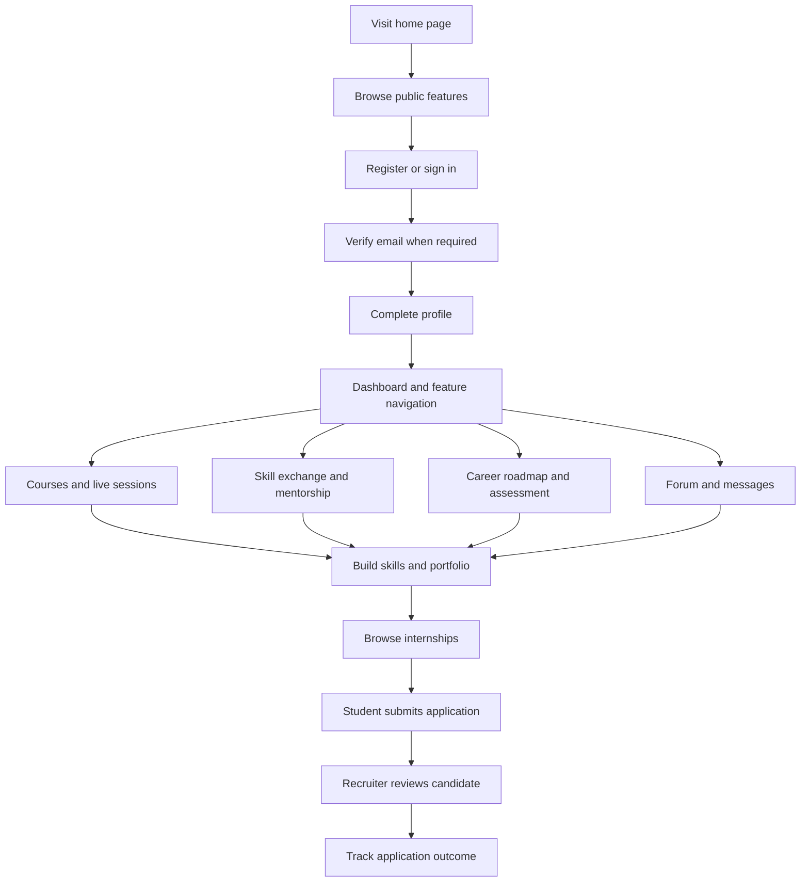
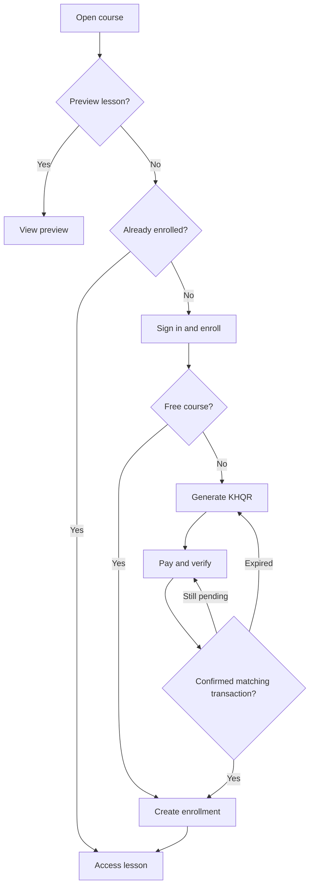
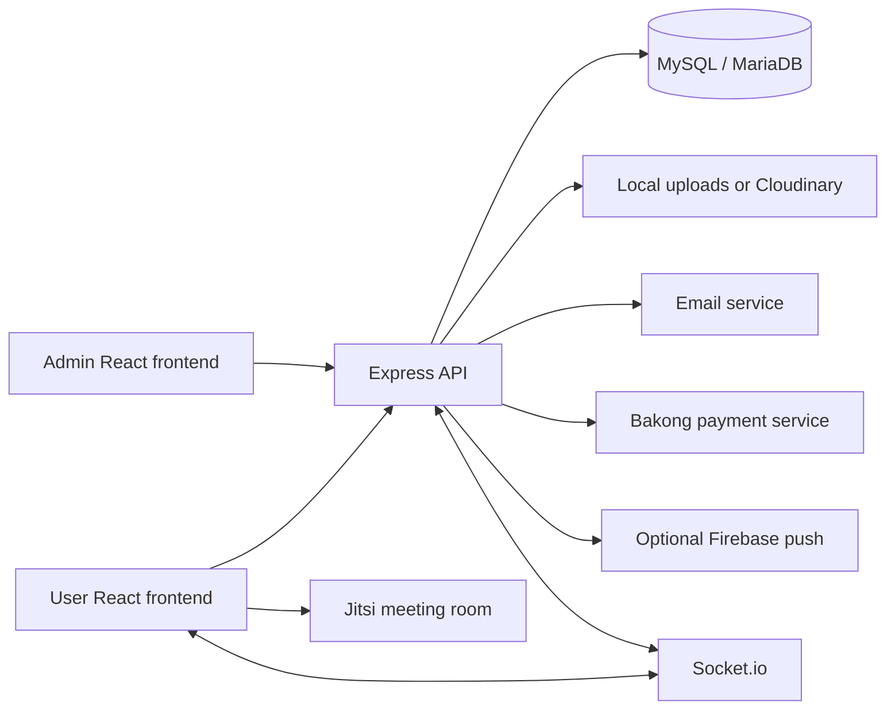

# Smart Community Skill & Career Development Platform

Complete website overview and user flows. Reviewed against the current project source on September 25, 2026.

This guide describes the pages, actions, permissions, and outcomes implemented in the repository. It is a source review, not a report of testing the deployed website. Features that require external services or have incomplete connections are identified below.

## 1. What the website is about

Smart Community helps students and community members develop practical skills and prepare for career opportunities. Users can study courses, exchange skills with peers, receive mentorship, attend live learning sessions, ask questions, build a professional profile, and apply for internships.

Mentors provide guidance and host learning sessions. Recruiters publish opportunities and manage applicants. Administrators manage accounts, review mentor and company profiles, moderate internship listings, and monitor platform activity.

The main learning journey is:

**Explore → Create an account → Build a profile → Learn and collaborate → Show your skills → Apply for opportunities → Track your progress.**

Courses, mentorship, skill exchange, and live sessions are separate activities. A user can choose the activities that fit their goals; completing all of them is not a requirement for applying to an internship.

## 2. Who uses the website

| Role | Main purpose | Main actions |
| --- | --- | --- |
| Visitor | Explore the platform | Browse public courses, mentors, sessions, career resources, internships, community activity, and forum discussions. |
| Student / community member | Learn and prepare for work | Manage a profile, access courses, request skill exchanges and mentorship, join sessions, participate in discussions, and use chat. Internship applications specifically require the `student` role. |
| Mentor applicant | Request permission to mentor | Submit professional details for administrator review. Selecting Mentor at registration does not immediately grant mentor access. |
| Approved mentor | Guide learners | Receive mentorship requests, approve or decline bookings, and schedule live sessions. |
| Recruiter | Find candidates | Manage a company profile, publish internships, review CVs, and update application statuses. |
| Administrator | Manage the platform | Manage accounts and roles, review mentors and companies, moderate internships, view analytics, and export reports. |

Some database and administrator screens also recognize a legacy `user` role. It should not be assumed to have every permission of `student`.

## 3. Overall flow

This diagram shows a typical student journey. Existing users can sign in and go directly to a feature.

## 4. Complete page map

Routes in this table belong to the user frontend. A public page may still require sign-in for actions such as booking, posting, or saving progress. Dynamic route values such as `:mentorId` identify a specific record.

| Page | Route | Access and purpose |
| --- | --- | --- |
| Home | `/` | Public introduction, feature links, learning journey, project team, and FAQ. |
| Dashboard | `/dashboard` | Signed-in starting point and shortcuts. Some cards currently use sample content. |
| Courses | `/courses` | Public course catalog; signed-in users can see their access status. |
| Course classroom | `/courses/:courseId` | Public course outline and preview lessons; full access depends on enrollment. The route parameter is used as the course slug by the service. |
| Live sessions | `/sessions` | Public session directory; registration requires sign-in. |
| Session details | `/sessions/:sessionId` | Opens the session directory page with the selected session. |
| Session room | `/sessions/:sessionId/room` | Signed-in host or eligible registered participant, within the join window. |
| Discover | `/discover` | Signed-in member discovery. |
| Member profile | `/discover/:memberId` | Signed-in profile viewing, skill request, and direct-message entry point. |
| Community | `/community` | Public community activity and signed-in personalized skill matches. |
| Skill requests | `/skill-requests` | Signed-in incoming/outgoing requests and learning history. |
| Exchange details | `/community/skill-exchange/:exchangeId` | Exchange participants view meeting details, progress, and completion. |
| Mentor directory | `/mentorship` | Public mentor browsing; signed-in booking management and mentor application. |
| Mentor details | `/mentorship/:mentorId` | Public mentor profile and reviews; booking requires sign-in. |
| Internships | `/jobs` | Public opportunities; applying requires a student account. |
| Applications | `/applications` | Students track applications; recruiters manage company, listings, and candidates. |
| My posts | `/my-posts` | Alternative route to the same internship dashboard. |
| Post an internship | `/post-job` | Signed-in route; publishing requires recruiter or administrator permission. |
| Career development | `/career` | Public resources; saved roadmap and assessment actions require sign-in. |
| Forum | `/forum` | Public discussion directory; publishing requires sign-in. |
| Discussion | `/forum/:postId` | Public post detail; answers, comments, and likes require sign-in. |
| Register | `/register` | Account creation. |
| Login | `/login` | Email/password or configured Google sign-in. |
| Verify email | `/verify-email` | Email verification and resend flow. |
| Forgot password | `/forgot-password` | Request a password-reset link. |
| Reset password | `/reset-password` | Set a new password using a valid reset token. |
| Profile | `/profile` | Signed-in profile and portfolio management. |
| Settings | `/settings` | Signed-in account details and preference controls; see implementation notes. |
| Messages | `/messages` | Signed-in conversation list and chat. |
| Conversation | `/messages/:conversationId` | Opens a specific conversation accessible to the member. |
| Notifications | `/notifications` | Signed-in activity center and notification preferences. |
| Analytics | `/analytics` | Administrator reporting; the API enforces the administrator role. |
| Administration | `/admin` | Administrator tools inside the user frontend. |
| Unknown address | Any unmatched path | Not-found page with navigation back into the website. |

An `About.jsx` file exists, but `/about` is not registered in the current router. The home page contains the platform introduction and project-team section.

## 5. First visit and navigation

1. A visitor opens `/` and reads the platform introduction.
2. They explore Learning, Mentors, Career, Internships, or Community. Other public destinations include live sessions and the forum.
3. They can switch between English and Khmer where translated interface text is provided. The browser remembers the selected language.
4. A protected destination shows sign-in and registration choices.
5. These choices include a return path so authentication can lead back to the requested page.
6. Once signed in, navigation includes Dashboard, Discover, Live sessions, Mentors, Community, Career, Internships, Messages, and Notifications. Other destinations are available through page links and profile navigation.

**Outcome:** visitors understand the website and can move from browsing into participation.

## 6. Registration, verification, login, and recovery

### New account

1. Open `/register` and select a role.
2. Enter name, email, password, and password confirmation.
3. Complete the relevant profile fields, including learning/teaching skills or recruiter information.
4. Submit the form. The backend validates the details and checks for an existing account.
5. When email verification is required, follow the verification link and complete verification at `/verify-email`. A resend option is available.
6. Sign in and continue to the requested page or `/dashboard`.

Email verification is enabled by default, but backend configuration can disable the requirement. When that requirement is disabled, registration can return an authenticated session directly.

Selecting Mentor initially creates a student account and a pending mentor application using the registration details. Administrator approval is needed before mentor access is granted. Public registration does not create administrator accounts.

### Returning user

**Login → Enter credentials → Optionally select Remember me → Validate account → Open requested page or dashboard.**

Google sign-in is an alternative when the Google client configuration is present. An unverified account is directed toward verification when verification is required. Invalid credentials and inactive accounts produce errors.

### Forgotten password

**Forgot password → Submit email → Receive reset link → Open reset page → Set new password → Sign in.**

An invalid or expired token requires a new link. Email delivery depends on SMTP configuration; local development can expose one-time links when SMTP is unavailable.

### Sign out

Signing out clears the browser authentication state and disconnects the real-time connection. Protected pages then require authentication again.

## 7. Profile and portfolio

1. Open `/profile`.
2. Add or update personal details, biography, career goal, availability, skills to teach, skills to learn, and social links.
3. Upload a profile image.
4. Add education, experience, certificates, and portfolio projects.
5. Update or remove individual entries as needed. Projects can include images and links.
6. Save the profile and use Discover, Community, or Career to continue.

**Outcome:** the member has a professional profile and skill information that supports discovery and recommendations. Certificates in this area are profile records; adding one does not mean the platform issued it.

## 8. Dashboard

**Sign in → Open `/dashboard` → Review the starting-page cards → Choose a next activity.**

The dashboard links to profile setup, courses, mentors, community skill exchange, live sessions, and internships. It presents a four-stage journey: profile setup, practical learning, mentorship and peer exchange, and career opportunities.

The current dashboard contains predefined events, job matches, and sample course content. Treat it as a navigation and presentation page; use the individual feature pages for saved bookings, real applications, and other account records.

## 9. Course browsing, payment, and learning

1. Open `/courses` and browse the published catalog.
2. Open a course to see its description, price, instructor, highlights, and lesson outline.
3. Select a preview lesson to try the available learning material.
4. To access locked lessons, sign in and start enrollment or purchase.
5. A free course enrolls the user directly through the enrollment/payment action.
6. A paid course creates or reuses an unexpired pending Bakong KHQR payment and displays the QR code with a countdown.
7. Scan and pay using a compatible payment application.
8. The frontend checks the payment status. The backend checks Bakong and validates the returned transaction against the expected payment.
9. A confirmed payment is saved, enrollment is created, and a course-unlocked notification is generated.
10. Open the unlocked lessons and use their video and PDF resources where provided.

**Other outcomes:** an expired QR requires a new payment code; a mismatched transaction does not unlock the course; an already enrolled user does not need another purchase. Paid access requires working Bakong configuration and connectivity.

The catalog reads an enrollment progress value, but the current course API does not provide a lesson-completion update flow. Automatic course-completion certificates are not established by the reviewed course implementation.

## 10. Member discovery

1. Open `/discover` while signed in.
2. Browse or search community members and inspect their skills.
3. Open `/discover/:memberId` to read a member profile.
4. Send a skill-exchange request or start a direct conversation.
5. Continue the request in `/skill-requests` or the conversation in `/messages/:conversationId`.

**Outcome:** a profile becomes the starting point for collaboration.

## 11. Skill exchange

1. Add teaching and learning skills to your profile.
2. Open `/community` for personalized matches, or find a member through Discover.
3. Choose the skill you want to learn, the skill you can offer, and a message explaining the exchange.
4. Submit the request. It starts as `pending`, and the receiving member is notified.
5. The receiving member opens `/skill-requests` and either accepts with a meeting date/time or declines with a reason. The sender can cancel a pending request.
6. An accepted request provides a direct conversation and a Jitsi meeting link.
7. Both participants can open the exchange detail page and record progress percentages and learning notes.
8. Each participant confirms completion.
9. After both confirmations, the exchange becomes `completed` and appears in learning history.

**Typical states:** `pending → accepted → completed`, with `pending → rejected` or `pending → cancelled` as alternatives. The interface labels rejected requests as declined.

**Rules:** users cannot request themselves; duplicate active requests to the same member are blocked; progress updates require an accepted exchange; setting progress to 100% alone does not replace both completion confirmations.

Matching uses comparisons between teaching skills, learning skills, and shared interests. The reviewed implementation calculates scores with explicit rules.

## 12. Mentorship

### Becoming a mentor

1. Sign in and open the mentorship area.
2. Submit a mentor application with professional background, expertise, and availability. If Mentor was selected during registration, a pending application already exists; check its status instead of submitting a duplicate.
3. The application enters `pending` review.
4. An administrator approves it or rejects it with a reason.
5. Approval grants the mentor role. Eligible active, verified mentors appear in the directory.

### Booking and completing mentorship

1. Browse `/mentorship` and open a mentor profile.
2. Review the mentor's expertise and published reviews.
3. Sign in and request a topic, future appointment time, duration, and meeting frequency.
4. The request becomes `pending` and appears on the personal booking board.
5. The mentor approves it, making it `active` and creating a scheduled session with a Jitsi meeting link, or rejects it with a reason.
6. Attend the agreed meeting and use the booking board to manage the engagement.
7. Mark an active mentorship completed.
8. The learner who made the completed booking can submit a rating and written review.

**Typical states:** `pending → active → completed`; pending requests can be rejected, and pending or active engagements can be cancelled.

**Rules:** users cannot book themselves or create another pending/active engagement with the same mentor. Reviews require a completed booking. A meeting-frequency choice records the requested cadence; it should not be described as an automatically generated calendar of recurring meetings.

## 13. Live learning sessions

### Host flow

1. An approved mentor or administrator opens `/sessions` and creates a session.
2. Enter the title, description, category, level, future date/time, duration, capacity, registration deadline, and optional material links.
3. Publish the session so learners can register.
4. Open the session to review participants and attendance.
5. Start/join the meeting, then complete or cancel the session as appropriate.

### Participant flow

1. Browse upcoming sessions and open the selected session.
2. Sign in and register before registration closes, while a place is available.
3. Cancel the registration if necessary.
4. Enter `/sessions/:sessionId/room` during the allowed join window.
5. Participate through the embedded Jitsi room, including audio/video, meeting chat, and screen sharing when available.
6. Leave the meeting. The platform records attendance and elapsed attendance time.
7. An attendee can submit a rating and feedback.

**Session states:** `scheduled`, `ongoing`, `completed`, and `cancelled`.

The join window starts 30 minutes before the scheduled time and ends two hours after the scheduled duration. Completed or cancelled sessions cannot be joined. A non-host must have an eligible registration. Feedback requires recorded attendance; the backend does not additionally require the session to be marked completed.

## 14. Internship and recruitment flows

### Recruiter creates opportunities

1. Register/sign in as a recruiter.
2. Open `/applications` and create a company profile with its name, contact details, description, website, and optional logo.
3. Open `/post-job`.
4. Enter the internship title, description, requirements, responsibilities, type, location/remote details, openings, dates, and stipend information as applicable.
5. Publish the opportunity. It is created as `open` and can appear in `/jobs`.
6. Manage listings through `/applications` or `/my-posts`, including setting them to `open`, `closed`, or `filled`.

Company review is an administrator feature, but the current publishing controller requires an existing company profile rather than requiring prior company approval.

### Student applies

1. Open `/jobs` and search or filter opportunities.
2. Read the selected listing and its requirements.
3. Sign in with the `student` role.
4. Upload a PDF CV and provide an optional portfolio URL and cover letter.
5. Submit before the deadline while the listing is open.
6. The application is saved as `pending`, and the recruiter is notified.
7. Open `/applications` to track the outcome and receive status notifications.

The backend blocks duplicate applications, invalid CV files, and applications to closed or expired opportunities.

### Recruiter reviews candidates

1. Open the internship dashboard and select an application.
2. Review the applicant's information, CV, portfolio, and cover letter.
3. Add private recruiter notes.
4. Set the application status to `pending`, `reviewed`, `shortlisted`, `approved`, or `rejected`.
5. Save the decision. The applicant receives an update.
6. Close or mark the internship filled when recruitment finishes.

**Example progression:** `pending → reviewed → shortlisted → approved`, or a move to `rejected`. These are available statuses; the backend does not force every application through every intermediate stage. Approval records a platform decision, not an automatically issued employment contract.

## 15. Career planning and assessment

1. Open `/career` to explore career paths, articles, and assessments.
2. Sign in to use personalized and saved features.
3. Review suggested paths and select a roadmap as your current plan.
4. Complete individual milestones as you make progress, or reopen a milestone if needed.
5. Review the updated completion percentage.
6. Read practical career advice articles.
7. Open an assessment, answer its questions, and submit it.
8. Review the saved results and radar chart across technical foundations, problem solving, project evidence, and career readiness.
9. Use the results to choose further learning, mentorship, and portfolio work.

Changing the active roadmap preserves progress from the previous path. The assessment is a self-assessment and guidance feature; it is not evidence of a professionally certified qualification.

## 16. Community forum

1. Open `/forum` to browse or search discussions by category.
2. Open a post at `/forum/:postId`.
3. Sign in to publish a question/discussion, add an answer or comment, or like useful content.
4. The question author can accept an answer and close or reopen their post.
5. Authors and administrators can remove content according to the corresponding ownership and role checks.
6. Related activity generates forum notifications for relevant users.

**Outcome:** useful conversations remain accessible as community knowledge.

## 17. Private messages and group chat

### Private conversation

**Discover member or open accepted exchange → Start/open conversation → Write message or attach file → Send → Recipient receives live update → Continue conversation.**

The Messages area provides conversation lists, unread indicators, and typing updates. Existing conversations can be reopened directly from `/messages`.

### Group conversation

1. Open `/messages` and choose the create-group control.
2. Enter a group name, optional description, and selected members.
3. Create the group and send messages using the conversation composer.
4. Members can view the group conversation and leave through the available control.

Messages support text, JPG/PNG/WebP images, and PDF/TXT/DOC/DOCX documents, with uploads limited to 10 MB. The backend checks membership before granting conversation access. Additional member-management endpoints exist in the API; their existence does not imply every action has a dedicated button in the current interface.

## 18. Notifications

1. A supported event occurs: a message, skill request, mentorship update, internship/application event, learning-session update, forum action, or system event.
2. The backend records a notification and can send a live Socket.io update.
3. The signed-in user sees activity through the notification UI and `/notifications`.
4. Select a notification to open its related page.
5. Filter by category or unread status, mark individual alerts read, mark a category/all alerts read, delete an alert, or clear read alerts.
6. Save category preferences to control enabled notifications.
7. If Firebase browser push is configured, the user can grant browser permission for background notifications.

**Outcome:** users can follow activity without repeatedly checking each feature. Background browser delivery depends on configuration, permission, and browser support.

## 19. Account settings and language

**Settings → Edit full name, biography, or availability → Save → Update account profile.**

The email field on this page is read-only. Dark mode, email-notification, and mentorship-match switches are present in the Settings interface, but the reviewed backend profile update does not persist those three fields. The page also displays its success message without awaiting the update result. Its partial update payload can reset other profile fields because the backend supplies empty defaults for omitted values. These are current implementation issues, so this page should not be described as a fully completed settings workflow.

Notification category preferences are implemented separately in the Notifications area. The English/Khmer language selection is remembered in browser storage; some screens still contain fixed English text.

## 20. Administration and reporting

The project has administrator pages inside the user frontend and a separate `frontend_admin` application. Their route roots refer to different applications.

| Separate admin route | Purpose |
| --- | --- |
| `/` | Overview of platform activity and pending work. |
| `/users` | Search accounts; manage roles, verification, activation, and suspension. |
| `/reviews` | Review mentor applications and company profiles. |
| `/internships` | Search and moderate internship listings. |
| `/analytics` | View platform reporting and trends. |
| `/audit` | Review administrator actions and export CSV reports. |

### Administrator flow

1. Open the administrator application and sign in with an administrator account.
2. Review the overview page for pending work.
3. Search a user and update the required account fields. Provide review/suspension reasons where required.
4. Review mentor applications and company profiles, recording approval or rejection decisions.
5. Review internship listings and update their status or moderation details.
6. Open Analytics and choose a reporting period.
7. Inspect counts, growth, role distribution, applications, popular skills, internship performance, mentor performance, and platform activity.
8. Use available print/report views or export CSV records from Audit & reports.
9. Review the audit trail and sign out when finished.

CSV report categories include users, mentor applications, companies, internships, applications, and audit history. Administrator API routes require both authentication and the administrator role.

## 21. How the website works behind the pages

The frontends display pages and collect user actions. The API validates input, authentication, roles, and record ownership, then reads or saves database records. Socket.io delivers live messages and activity updates. Uploaded files use local storage or Cloudinary according to configuration.

The main API groups are `/api/auth`, `/api/profile`, `/api/messages`, `/api/admin`, and feature endpoints directly under `/api`.

## 22. Current implementation boundaries

| Area | What the current source establishes |
| --- | --- |
| Dashboard | Several cards use sample/predefined content rather than live account records. |
| Course learning | Catalog, previews, enrollment, payment, and resource access exist; a lesson-completion update endpoint and automatic certificate issuance are not established. |
| Settings | Profile fields are connected; the three preference switches described above are not persisted by the profile API. |
| Account deletion | A context helper named `deleteAccount` clears local authentication; it is not a backend account-deletion workflow. |
| About page | An About component exists, but there is no registered `/about` route. |
| Recommendations | Skill matching uses explicit scoring rules. An AI-generated label or marketing statement should not be taken as proof of an external AI service. |
| Company verification | Administrators can review companies, but existing company approval is not enforced as a publishing prerequisite by the current create-internship controller. |
| Meeting access | Jitsi links are generated for meetings. Do not infer additional meeting-provider privacy guarantees from the platform's page-access checks. |
| Telegram alerts | A standalone payment-alert bot exists in `telegram_bot/`; the reviewed course-payment controller does not call it. |
| External services | Google sign-in, SMTP email, Bakong payments, Cloudinary uploads, Jitsi, and optional Firebase push depend on their own configuration and availability. |
| Translation | English and Khmer language support exists; translation coverage varies by screen. |

## 23. Suggested website demonstration

1. Show the home page and explain the platform's learning-to-career purpose.
2. Register/sign in and show a completed student profile.
3. Open a course and demonstrate a preview. Explain how verified payment unlocks paid lessons.
4. Find a community member and send a skill request.
5. Use the receiving account to accept it, then show chat, meeting information, progress, and both completion confirmations.
6. Book a mentor and show the mentor's approval flow.
7. Register for a live session and explain the meeting and attendance flow.
8. Select a career roadmap and complete a self-assessment.
9. Publish a forum question and show an answer or comment.
10. Use a recruiter account to show the company profile and an open internship.
11. Use a student account to submit a PDF CV and track the application.
12. Use the recruiter account to review it and update the status.
13. Show the resulting notifications.
14. Finish with the administrator's review center, analytics, and audit reports.

Use prepared records and accounts for each role. A real payment demonstration should be performed only when explicitly intended and with the payment service configured.

## 24. Source reference map

| Subject | Main implementation sources |
| --- | --- |
| User routes and protected-page behavior | `frontend_user/src/App.jsx`, `frontend_user/src/components/auth/RequireAuth.jsx` |
| Navigation and language | `frontend_user/src/data/navLink.js`, `frontend_user/src/context/LanguageContext.jsx` |
| Authentication | `backend/src/routes/authRoutes.js`, `backend/src/controllers/authController.js`, `backend/src/config/authFeatures.js` |
| Feature routes and role requirements | `backend/src/routes/platformRoutes.js` |
| Profile and settings | `backend/src/routes/profileRoutes.js`, `backend/src/controllers/profileController.js`, `frontend_user/src/pages/settings/Settings.jsx` |
| Dashboard presentation | `frontend_user/src/pages/dashboard/Dashboard.jsx` |
| Courses and payment | `backend/src/controllers/courseController.js`, `backend/src/services/bakongPaymentService.js`, `frontend_user/src/pages/courses/CourseDetail.jsx` |
| Skill exchange | `backend/src/controllers/platformController.js`, `backend/src/controllers/skillExchangeController.js` |
| Mentorship | `backend/src/controllers/mentorshipController.js` |
| Learning sessions | `backend/src/controllers/learningSessionController.js` |
| Internships | `backend/src/controllers/internshipController.js` |
| Career development | `backend/src/controllers/careerController.js`, `frontend_user/src/pages/career/CareerDevelopment.jsx` |
| Forum | `backend/src/controllers/forumController.js` |
| Chat | `backend/src/routes/messageRoutes.js`, `backend/src/controllers/messageController.js`, `backend/src/sockets/index.js` |
| Notifications | `backend/src/controllers/notificationController.js`, `backend/src/services/notificationDeliveryService.js` |
| Administration | `frontend_admin/src/App.jsx`, `backend/src/routes/adminRoutes.js`, `backend/src/controllers/adminController.js` |
| Analytics | `backend/src/controllers/analyticsController.js` |
| Standalone Telegram helper | `telegram_bot/README.md`, `telegram_bot/server.js` |
